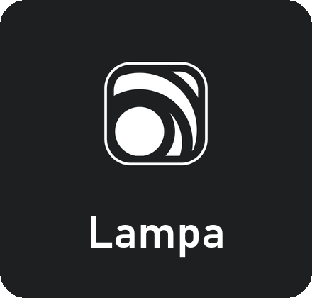
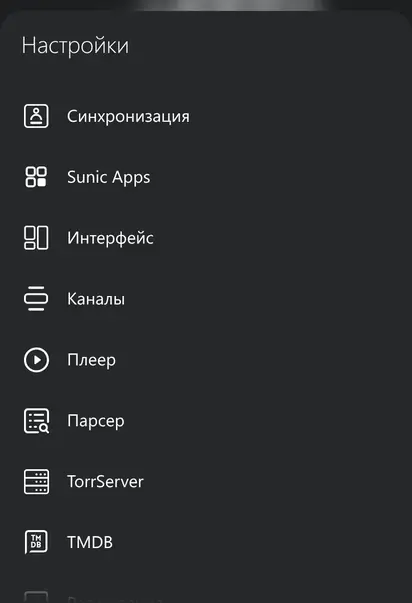
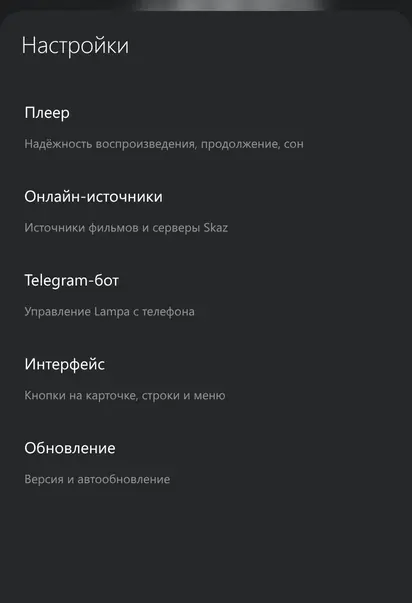
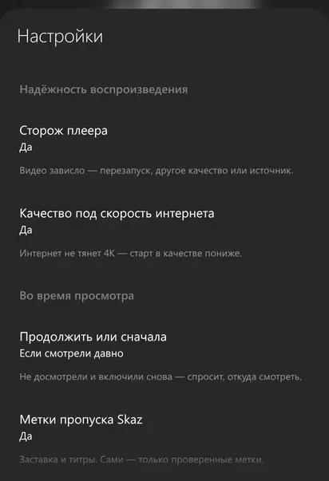
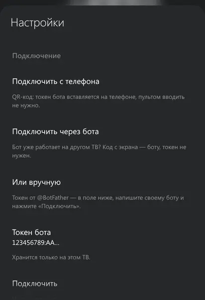

<picture></picture>

<p align="center"><b>Android'dagi Lampa</b> uchun <b>Sunic Apps</b> imkoniyatlari — telefon, planshet, Android TV va pristavkalar.<br>Telegram-bot, «to'xtagan joydan davom ettirish», pleer qo'riqchisi va manbani avtomatik tanlash — alohida ilovasiz, plagin sifatida.</p>

<p align="center">
<a href="https://github.com/sunic007/lampa-android/releases/latest"></a>
<picture></picture>
<picture></picture>
<a href="https://t.me/sunicapps"></a>
</p>

<p align="center"><a href="README.md"> English</a>&nbsp;&nbsp;&nbsp;<a href="README.ru.md"> Русский</a>&nbsp;&nbsp;&nbsp;<picture></picture> <b>O'zbekcha</b></p>

<p align="center"><sub>Bepul · Android 6+ · <a href="CHANGELOG.md">Yangiliklar</a> (RU) · <a href="../docs/DEVELOPMENT.md">Dasturchilar uchun</a> (RU)</sub></p>

<br clear="left">

## Qanday ulash

<div align="justify">

1. Android'da Lampa'ni oching — masalan, <b>Lampa BS</b>.
2. <b>Настройки → Расширения → Добавить плагин</b> (Sozlamalar → Kengaytmalar → Plagin qo'shish).
3. Manzilni qo'ying va tasdiqlang:

</div>

```
https://sunic007.github.io/lampa-android/sunic.js
```

<div align="justify">

4. Lampa'ni qayta ishga tushiring. Sozlamalarda <b>«Sunic Apps»</b> bo'limi paydo bo'ladi — «Синхронизация» (Sinxronizatsiya) ostida.

Shundan keyin plagin GitHub'dan o'zi yangilanadi. Yangi versiya chiqsa, Lampa «Вышло обновление» (Yangilanish chiqdi) oynasini ko'rsatadi va uni keyingi ishga tushirishda o'rnatadi.

</div>

<p align="center">
  <picture></picture>
  <picture></picture>
  <picture></picture>
  <picture></picture>
</p>


## Imkoniyatlar

<div align="justify">

<a href="https://github.com/sunic007/lampa-samsung">Samsung uchun Lampa</a>dagi imkoniyatlarning o'zi — bu bir xil kod:

- <b>Telegram-bot</b>: telefondan qidirish, «▶️ Смотреть» (Ko'rish) — film Lampa'da boshlanadi, yangi qismlar va «yaxshi sifatda chiqdi» xabarlari. Bir nechta qurilma uchun bitta bot — «Подключить через бота» (Bot orqali ulash) kodi.
- <b>To'xtagan joydan davom ettirish</b>: bitta OK — o'sha qism, o'sha manba, o'sha ovoz.
- <b>Pleer qo'riqchisi</b>: video qotib qolsa — qayta ishga tushirish, boshqa sifat yoki boshqa manba.
- <b>Ko'rish paytida</b>: kirish va titrlarni o'tkazib yuborish, «Keyingi qism» sanog'i, «Hali ko'ryapsizmi?», uyqu taymeri, audio yo'lakni eslab qolish.
- <b>Manbalar</b>: manbani avtomatik tanlash, oldindan tekshirish, Skaz serverlarini tanlash, tanlash uchun boshqa onlayn manbalar.
- <b>Interfeys</b>: kartochkada bitta «Смотреть» tugmasi, menyuda «Турецкие сериалы» (Turk seriallari), ishga tushganda «Новые серии» (Yangi qismlar).

</div>

## Samsung uchun Lampa'dan farqi

<div align="justify">

- <b>Pleer, reklama va Lampa'ning o'zini yangilash</b> — ilovaga bog'liq, plagin ularga tegmaydi. «Ko'rish paytida» imkoniyatlari Lampa'ning ichki pleerida ishlaydi.
- <b>Bot Lampa ochiq turganda javob beradi</b> (Samsung televizorida u Lampa yopiq bo'lsa ham ishlaydi — u yerda bu paket xizmati).
- <b>Faqat Samsung'da bor narsalar yo'q</b>: Smart Hub paneli va televizor ovozi.
- <b>«Парсер» (Parser) va «TorrServer»</b> darhol ko'rinadi (televizorda ular kerak bo'lgunicha yashirin).

</div>

## Ko'p beriladigan savollar

<details>
<summary><b>Kengaytmalarda 404 xatosi yoki «Не удалось проверить» (tekshirib bo'lmadi)</b></summary>
<br>
<div align="justify">Manzilni tekshiring — u aynan <code>https://sunic007.github.io/lampa-android/sunic.js</code> bo'lishi kerak. «Tekshirib bo'lmadi» internet sekin bo'lganda chiqadi: Lampa'ni qayta ishga tushiring — plagin yuklangan bo'lsa, «Sunic Apps» bo'limi paydo bo'ladi.</div>
</details>

<details>
<summary><b>Televizordagi o'sha botni qanday ulash mumkin</b></summary>
<br>
<div align="justify">Android'da: <b>Настройки → Sunic Apps → Telegram-бот → «Подключить через бота»</b> — ekranda kod paydo bo'ladi. Uni Telegram'da televizorda ishlab turgan botga yuboring. Tokenni qayta kiritish shart emas.</div>
</details>

<details>
<summary><b>Qaysi ilovalar mos keladi</b></summary>
<br>
<div align="justify">Ilova ko'prigi bor Android uchun Lampa — masalan, <b>Lampa BS</b>. Lampa BS 0.1.0.935 (Lampa 3.3.2) da tekshirilgan. Boshqa ilovada nimadir noto'g'ri bo'lsa, <a href="https://t.me/sunicapps">guruhga</a> yozing.</div>
</details>

<details>
<summary><b>Qanday o'chirish mumkin</b></summary>
<br>
<div align="justify"><b>Настройки → Расширения</b> (Sozlamalar → Kengaytmalar) → «Sunic Apps» plagini → o'chirish, so'ng Lampa'ni qayta ishga tushiring.</div>
</details>

## Ma'lumotlar va maxfiylik

<div align="justify">

Plagin reklama va analitika qo'shmaydi, dasturchi sizning ma'lumotlaringizni olmaydi. Telegram-bot qurilmangizdagi Lampa'da ishlaydi: uning tokeni, siz ruxsat bergan odamlar va ro'yxatlaringiz faqat o'sha yerda saqlanadi. Telefonni ulash ntfy.sh xizmati orqali shifrlangan holda o'tadi. Filmlar haqidagi ma'lumotlar — TMDB'dan. AI-qidiruv tavsif yoki skrinshotni faqat siz kalitini qo'shgan AI xizmatiga yuboradi. Lampa'da yoqadigan uchinchi tomon onlayn manbalari ilova ichida ishlaydi — faqat ishonganlaringizni yoqing.

</div>

## Loyihadan foydalanish

<div align="justify">

Plaginni o'z loyihangiz, yig'ma, maqola yoki videoda ishlatmoqchimisiz? Marhamat — faqat <b>shu repozitoriyga havola qoldiring</b>. <b>Menga xabar bersangiz</b> (ixtiyoriy) xursand bo'laman: <a href="https://t.me/sunicapps">Telegram guruhiga</a> yozing yoki <a href="https://github.com/sunic007/lampa-android/issues/new/choose">issue</a> oching. Kod — MIT litsenziyasi bo'yicha.

</div>

## Loyihani qo'llab-quvvatlash

<div align="justify">

Sunic Apps — bepul. Plagin sizga yordam bergan bo'lsa, rivojlanishini <a href="https://github.com/sponsors/sunic007"><b>GitHub Sponsors</b></a>da qo'llab-quvvatlashingiz mumkin (Lampa'da: «Настройки → Sunic Apps → Обновление → Поддержать проект»).

</div>

---

<div align="justify"><sub>Loyiha filmlar, seriallar va boshqa materiallarni saqlamaydi, joylamaydi va tarqatmaydi hamda u bilan ishlatilishi mumkin bo'lgan kontent xizmatlariga aloqador emas. Android — Google LLC savdo belgisi; loyiha Google'ga aloqador emas. Telegram — Telegram FZ-LLC savdo belgisi; loyiha Telegram'ga aloqador emas. Filmlar haqidagi ma'lumotlar — <a href="https://www.themoviedb.org">TMDB</a>: bu mahsulot TMDB API'dan foydalanadi, lekin TMDB tomonidan ma'qullanmagan va sertifikatlanmagan. Lampa — <a href="https://github.com/yumata/lampa">yumata/lampa</a> loyihasi; Lampa BS ilovasi, plaginlar va server — <a href="https://lampabs.com">byskaz</a>; plagin ularni o'zgartirmaydi va ularning tarkibiga kirmaydi. Uchinchi tomon komponentlari — <a href="../licenses/THIRD_PARTY_NOTICES.md">THIRD_PARTY_NOTICES.md</a>.</sub></div>
